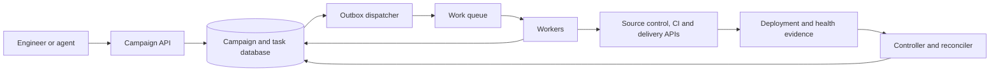

# Fleet change platform design

[Preparation index](../README.md) · [Interview evidence](../interview-context.md)

Practice scenario for Netflix L5 Developer Platform. The follow-ups are
preparation questions, not confirmed Netflix interview questions.

> Design a platform that upgrades a shared library across thousands of
> repositories and services. Engineers can select targets, inspect a plan,
> launch a campaign, observe progress, pause execution, and recover from
> failures. Some changes may be generated by an AI agent.

Before drawing components, establish what "completed" means. These are
different outcomes:

- A patch was generated.
- A pull request was opened.
- The change was merged.
- An artifact containing the change was built.
- That artifact reached the intended environments.
- Its behavior was validated.

If the system declares success after opening a PR, it cannot also claim the
fleet has been upgraded.

A reasonable practice architecture is:

The database records durable intent and progress. Workers perform bounded
operations. The controller decides which work is eligible and whether
execution may advance. The reconciler compares recorded progress with external
reality. An outbox dispatcher publishes recorded work to the queue; workers
call source control, CI, and delivery systems, and evidence feeds back into
the controller's decisions.

At the stated scale, a relational database is a defensible starting point
because the system needs transactions, uniqueness, conditional updates, and
queries across campaigns and tasks. Large logs and artifacts can live
elsewhere. A database-backed work queue may also be sufficient initially;
justify a separate broker through throughput, isolation, or integration
requirements.

Be able to explain a small data model:

| Entity | Important fields |
|---|---|
| Campaign | Owner, immutable plan revision, target-selection policy, desired change, lifecycle state |
| Target | Repository/service identity, expected starting revision, intended resulting revision, eligibility |
| Step | Target, operation type, prerequisites, current state, state version |
| Attempt | Attempt ID, worker, ownership generation, start/heartbeat times, outcome |
| External operation | Stable operation ID, downstream system, external reference, observed outcome |
| Validation | Artifact or deployment being evaluated, policy version, evidence, freshness, result |

**An operation ID identifies the intended effect; an attempt ID identifies one
try.** Changing the operation ID on every retry defeats downstream
deduplication.

| Follow-up | What a strong answer should contain |
|---|---|
| **The API times out after accepting a campaign. The user submits again.** | A caller-provided idempotency key; a durable association with the original request; detection of the same key with different parameters; returning the existing campaign. |
| **The database write succeeds, but publishing work fails.** | An atomic boundary covering state and dispatch intent. For example, write an outbox row in the same transaction, then publish asynchronously. The dispatcher may publish twice, so consumers still need duplicate handling. |
| **A worker creates a PR and crashes before updating the database.** | Preserve the stable operation identity, find the existing downstream operation, reconcile the uncertain outcome, and avoid blindly creating another PR. |
| **Two campaigns update the same repository.** | Define the conflict domain. Use expected revisions and a policy for serialization, rebasing, supersession, or rejection. A campaign-level lock does not resolve conflicts between campaigns. |
| **A worker's lease expires while it is still running.** | Explain stale ownership, generation checks, and the limits of protecting only the platform database. External effects need compatible protection too. |
| **The user pauses the campaign. What stops immediately?** | Distinguish stopping new dispatch from interrupting running work. Define cancellation acknowledgment and safe interruption points. Some external operations will already be committed. |
| **Ten percent of targets fail. Do you roll everything back?** | Classify failures, assess shared causes, stop further expansion when warranted, and choose per-target retry, repair, compensation, or rollback according to the operation. |
| **The migration changes a database schema.** | Compatibility across mixed application versions; expansion before contraction; a rollback window; recognition that reversing code may not reverse data changes. |
| **Two campaigns each respect a rollout limit but together overload one service.** | Shared concurrency or disruption budgets for the affected service or failure domain, rather than independent limits only within each campaign. |
| **An agent generated the change. What changes architecturally?** | The same bounded execution APIs and validation contracts apply. Bind execution to the reviewed plan and artifact; revalidate permissions and preconditions when performing mutations. |
| **How do you prove the platform helped?** | Verified completion, time spent blocked, intervention rate, failure and rollback rates, and remaining exposure. PR counts alone are a weak outcome metric. |

One particularly valuable deep dive is **the transaction boundary around
external effects**. A transaction in the campaign database cannot atomically
commit a deployment in another platform. Be explicit about where the
guarantees end.

Netflix's Maestro engineering article provides a useful concrete example of
durable state, transactionally recorded work, recovery, and at-least-once
delivery. Its internal guarantees should not be generalized into a claim that
arbitrary external actions happen exactly once.
[Maestro workflow-engine redesign](https://netflixtechblog.com/100x-faster-how-we-supercharged-netflix-maestros-workflow-engine-028e9637f041)
